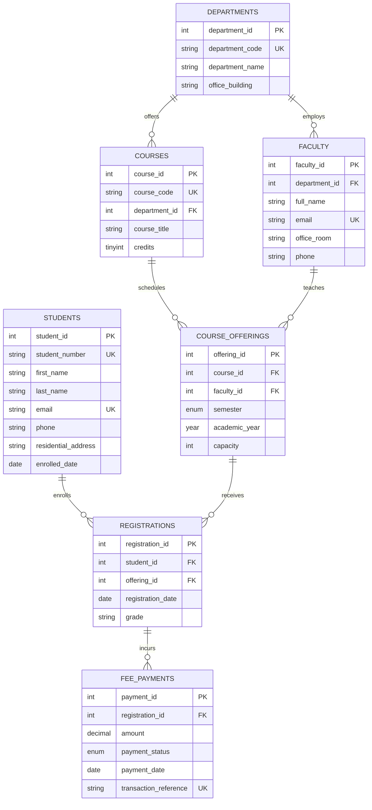

# Day 18: Relational Database Concepts — Normalization to 3NF & ER Modeling

## Objective
Take a de-normalized, flat `college_registrations` spreadsheet containing student, course, faculty, registration, and fee payment data, analyze its relational anomalies (insertion, deletion, update), and normalize it step-by-step to **Third Normal Form (3NF)**. Provide the comprehensive ER diagram and executable SQL DDL schema.

---

## Normalization Summary

```
UNNORMALIZED SPREADSHEET (UNF)
        │
        ▼ (Ensure atomic values, remove repeating groups, establish PK)
FIRST NORMAL FORM (1NF)
        │
        ▼ (Eliminate Partial Functional Dependencies on composite keys)
SECOND NORMAL FORM (2NF)
        │  ├── Students
        │  ├── Courses
        │  ├── Faculty
        │  └── Course Offerings & Registrations
        │
        ▼ (Eliminate Transitive Functional Dependencies: dept_name from course/faculty)
THIRD NORMAL FORM (3NF)
        ├── departments
        ├── faculty
        ├── courses
        ├── students
        ├── course_offerings
        ├── registrations
        └── fee_payments
```

---

## Entity-Relationship (ER) Diagram



---

## Directory Structure

```
day-18-relational-database-concepts/
├── normalization-worksheet.md      # Detailed step-by-step breakdown & dependency analysis
├── schema-3nf.sql                  # Production-ready MySQL DDL with constraints & seed data
└── README.md                       # Comprehensive guide and Mermaid ER model
```

---

## Relational Anomalies Resolved

1. **Insertion Anomaly Resolved**:
   - Courses and Faculty can now be created in `courses` and `faculty` tables before any student enrolls in them.
2. **Deletion Anomaly Resolved**:
   - Dropping a student's enrollment record from `registrations` only removes that enrollment; course catalog and faculty records remain completely intact.
3. **Update Anomaly Resolved**:
   - Modifying a department name or faculty room number requires updating exactly one row in `departments` or `faculty`, guaranteeing system-wide consistency.
4. **Data Redundancy Resolved**:
   - Textual strings (course titles, student addresses, emails) are stored exactly once, referenced everywhere else by compact primary key integers.

---

## How to Verify & Execute Schema

Execute in MySQL CLI or MySQL Workbench:
```bash
mysql -u root -p < schema-3nf.sql
```
